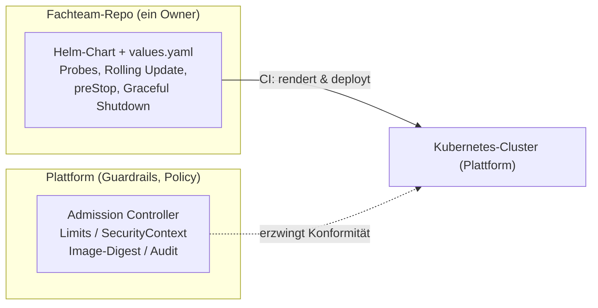

### Summary

- Haben Entwickler und Plattform-Team gemeinsam die Verantwortung für Helm-Charts, führt dies zu Konflikten bei Änderungen und unklarer Zuständigkeit bei Fehlern.
- Daher gehört das komplette Helm-Chart dem fachlichen Entwicklungsteam, d. h. das gesamte Repo hat nur einen Owner.
- Die Plattform verliert dadurch keine Kontrolle, sondern die Grenze wandert von der Miteigentümerschaft zum Aufsetzen von Guardrails außerhalb des Charts.

### Der Rollout funktioniert nicht – und keiner kennt die Ursache

Es ist Dienstagabend, der Rollout des Zahlungsverkehrs-Services bricht in der Produktion ab. Pods starten nicht und gehen reihenweise in den Status `CrashLoopBackOff`. Jetzt ist die Frage: Ist es der `values.yaml`-Block, den das Fachteam für die neue Umgebung angepasst hat – oder der `securityContext`, den die Plattform im selben Chart-Repo nachgezogen hat?

Zwei Teams, ein Helm-Chart, eine gemeinsame Fehlersuche. In genau dieser Situation, so meine Erfahrung, scheitert geteilte Chart-Verantwortung. Nicht an fehlender Kompetenz, sondern an der Struktur selbst.

> **Wer besitzt dieses Chart – das Fachteam oder die Plattform?**

Auf den ersten Blick scheint eine Aufteilung in einen festen Basisteil, bereitgestellt vom Plattformteam, und einem schlanken Teil für die Anwendung eine gute Idee zu sein. In der Praxis ergeben sich daraus jedoch mehr Probleme, als dass es nutzt.

### Warum geteilte Chart-Verantwortung scheitert

Die Aufteilung klingt logisch, weil Plattform- und Anwendungswissen tatsächlich bei zwei Rollen liegen. Allerdings hat sich schon immer auch bei den Repos der Anwendungen selbst gezeigt, dass es Probleme gibt, wenn zwei Teams gleichzeitig für ein Repo zuständig sind.

- **Aufteilung einer Datei nach Teams**: Zeile 40 gehört dem Plattformteam, Zeile 80 dem Fachbereich. Jede Änderung braucht Reviews aus beiden Lagern – und man blockiert sich gegenseitig, sobald ein Team gerade keine Kapazität hat.
- **Inkompatibilitäten von Basis-Chart-Versionen**: Das Plattformteam hebt das Basis-Chart auf eine neue Version, das Fachteam arbeitet noch auf der alten. Kein Vorgang ist falsch, aber kann zu einem kaputten Helm-Chart führen.
- **Die Fehlerzuständigkeit ist unklar**: Bricht der Rollout ab, weiß niemand, ob es am `values` des Fachbereichs oder am `securityContext` der Plattform lag. Die Fehlersuche dauert daher Stunden statt Minuten.
- **Conway's Law schlägt zu**: Die Chart-Struktur spiegelt die organisatorische Reibung wider, statt sie aufzulösen. Jede Zeile wird zum Verhandlungsgegenstand zwischen zwei Abteilungen.

Der häufigste Reflex darauf ist ein Base-plus-App-Split: ein geteiltes Basis-Chart für alle, ein dünnes App-Chart darüber. Das klingt nach Wiederverwendung, verschiebt das Problem aber nur. Denn jetzt liegt die Verantwortung zwischen zwei Charts – im Base steckt Plattformlogik, im App-Chart Anwendungslogik, und die Grenze dazwischen ist genauso unklar wie vorher. Geteilte Struktur bleibt geteilte Verantwortung.

### Die These: Ein Chart muss genau einen Owner haben

Die Konsequenz daraus ist:

> **Das komplette Helm-Chart gehört dem fachlichen Entwicklungsteam.**

Ein Repository hat genau einen Owner und es gibt keine geteilten Zeilen. Das Team, das den Service baut, besitzt auch dessen Deployment-Artefakt. Es kennt die Health-Checks und Endpunkte für Metriken, die richtige Rolling-Update-Strategie, das Shutdown-Verhalten seiner Anwendung – und es ist die einzige Rolle, die bei einem fehlgeschlagenen Deployment wirklich alle Antworten hat.

Das Plattformteam wird von der Rolle des Chart-Mitbesitzers entlastet. Was bleibt, ist die Rolle, die ihm ohnehin gehört, nämlich die Festlegung von Leitplanken. Betrieb der Plattform heißt in der DevOps-Welt eben nicht mehr, dass die Betriebsverantwortung komplett beim Plattformteam liegt, sondern dass die fachlichen Entwickler die Verantwortung für den Betrieb ihrer Anwendungen übernehmen.

### Verantwortlichkeit vs. Guardrails

Das heißt aber nicht, dass das Plattformteam einen Kontrollverlust befürchten muss. Lediglich die Grenze zwischen den Teams verschiebt sich nach außerhalb des Charts.

Im Cluster selbst hat weiterhin das Plattformteam das Sagen und kann beispielsweise mithilfe von Admission-Controllern nicht-konforme Deployments ablehnen. Eine weitere wichtige Rolle besteht darin, Vorlagen und Anleitungen zu erstellen, die den Best-Practices folgen. Wer das Chart besitzt, entscheidet also darüber, *wie* deployed wird. Die Plattform entscheidet weiterhin, *was* erlaubt ist.

### Der ehrliche Trade-off

Verantwortlichkeit beim Fachteam ist kein Freifahrtschein. Ohne starke Vorgaben und Guardrails würde sich ein Wildwuchs breitmachen und man wundert sich Jahre später über zehn Varianten desselben Deployments. Verantwortung ohne Leitplanken wird schnell zum Problem.

Im regulierten Umfeld bleibt dieser Trade-off trotzdem tragfähig, weil die Regeln, auf die es dort ankommt (Limits, SecurityContext, Security-Audits), nicht im Chart verankert, sondern außerhalb davon erzwungen werden. Was der Prüfer sehen will, hängt an der Policy und der Git-Historie, nicht am Chart. Die Freiheit des Teams endet genau dort, wo die Guardrails der Plattform beginnen – und in dieser Reihenfolge funktioniert es.

### Praxis: das Chart, das jetzt dem Team gehört

Was heißt „das Chart gehört dem Team“ konkret? Es heißt, dass die Teile des Charts, die Fachwissen über die Anwendung enthalten, in team-eigener Verantwortung liegen. Für einen Spring-Boot-Zahlungsservice ist das zum Beispiel:

- **Health-Checks**: `livenessProbe` und `readinessProbe` kennen die Startzeit der Anwendung und den echten Bereitschaftszustand – nicht ein Standardwert aus einem fremden Base-Chart.
- **Rolling-Update-Strategie**: `maxSurge`/`maxUnavailable` so gewählt, dass der Zahlungsverkehr während des Updates durchgehend bedient wird.
- **Graceful Shutdown**: `preStop`-Hook plus `terminationGracePeriodSeconds`, damit laufende Transaktionen sauber abschließen, bevor der Pod verschwindet.

Ein Ausschnitt aus `templates/deployment.yaml` im GitOps-Repo eines Payment-Services:

```yaml
spec:
  strategy:
    type: RollingUpdate
    rollingUpdate:
      maxSurge: 1
      maxUnavailable: 0
  template:
    spec:
      terminationGracePeriodSeconds: 60
      containers:
        - name: payment-service
          lifecycle:
            preStop:
              exec:
                # Dem Load-Balancer Zeit geben, den Pod auszunehmen,
                # bevor die Anwendung den Shutdown startet.
                command: ["/bin/sh", "-c", "sleep 10"]
          readinessProbe:
            httpGet:
              path: /readyz
              port: http
            initialDelaySeconds: 15
            periodSeconds: 10
            failureThreshold: 3
            successThreshold: 2
          livenessProbe:
            httpGet:
              path: /livez
              port: http
            initialDelaySeconds: 30
            periodSeconds: 10
            failureThreshold: 30
            successThreshold: 1
```

Der passende Spring-Boot-Teil ist genauso unspektakulär – Graceful Shutdown aktivieren, damit der `preStop`-Hook wirkt:

```yaml
server:
  shutdown: graceful
management:
  endpoint:
    health:
      probes:
        # Health-Check unter /livez und /readyz zur Verfügung stellen
        add-additional-paths: true
spring:
  lifecycle:
    timeout-per-shutdown-phase: 30s
```

Das ist die Art von Detail, die nur das Team kennt, das den Service betreibt. Ein Beispiel sind die Schwellenwerte der Probes: Weil der Service mit Camunda relativ lange startet, wird ein problematischer Pod über die Readiness-Probe zügig aus dem Verkehr gezogen (`failureThreshold: 3`), während ein Neustart über die Liveness-Probe erst nach fünf Minuten (`failureThreshold: 30`) angestoßen wird. Für schnell startende Services wäre genau die Umkehrung richtig – ein Standard-Chart kann diese Abwägung nicht kennen. Und genau deshalb gehört das Chart in die Verantwortung des Teams. Die Versionierung des Charts folgt dabei *semantic versioning* im Team-Repo – jede Änderung ist in der Git-Historie nachvollziehbar.

Wie die Grenze zwischen Chart und Policy verläuft, zeigt das folgende Diagramm. Das Chart rendert und deployt, die Plattform erzwingt:



Die Zuständigkeiten im Überblick:

| Aspekt | Fachteam (besitzt Chart) | Plattformteam (besitzt Policy) |
| :--- | :--- | :--- |
| Chart-Struktur, Probes, Deploy-Logik | Owner | – |
| Ressourcen-Limits, SecurityContext, Labels | setzt sie im Chart | erzwingt sie via Admission Controller |
| Secrets | referenziert sie | stellt den Mechanismus zur Verfügung |
| Chart-Vorlage, Standards | orientiert sich an Vorgaben | pflegt Demo-Chart und Standards |
| Audit / Traceability | PR- und Git-Historie | GitOps + Policy-Reporting |

### Anti-Patterns (Checkliste)

Wenn Ihnen eines dieser Muster bekannt vorkommt, ist die Ownership unklar:

- [ ] unterschiedliche Owner innerhalb eines Charts – eine Datei, zwei Teams.
- [ ] Chart als Dependency eingebunden, aber niemand verantwortet die eingebundene Version.
- [ ] Plattform-Eingriffe per Hand am laufenden Deployment statt über Policy-as-Code.

### Die 3 wichtigsten Takeaways

1. **Geteilte Chart-Verantwortung scheitert strukturell** – an geteilter Zuständigkeit für dieselbe Datei, Versions-Drift und Fehlern, die niemandem zuzuordnen sind, nicht an den Menschen.
2. **Ein Chart, ein Owner:** Das komplette Chart gehört dem fachlichen Entwicklungsteam, das seinen Service kennt.
3. **Ownership ≠ Enforcement:** Die Plattform behält die Kontrolle, weil Guardrails außerhalb des Charts per Policy-as-Code durchgesetzt werden.

**Und wie ist das bei Ihnen geregelt: Ist das Fachteam vollständig für sein Chart verantwortlich – oder teilen sich Anwendung und Plattform ein Chart?**

Wenn Sie die Rollen zwischen Anwendungsentwicklung und Plattform in Ihrer Organisation schärfen möchten, sprechen wir gerne in einem unverbindlichen [30-minütigen Fachgespräch](/termin) über Ihre Ausgangslage.

*Dieser Beitrag ist Teil der Serie zur Migration geschäftskritischer Workloads im Bankenumfeld. In den folgenden Teilen geht es um Strangler-Fig-Strategien, DORA-Kennzahlen und Zero-Downtime-Deployments.*
