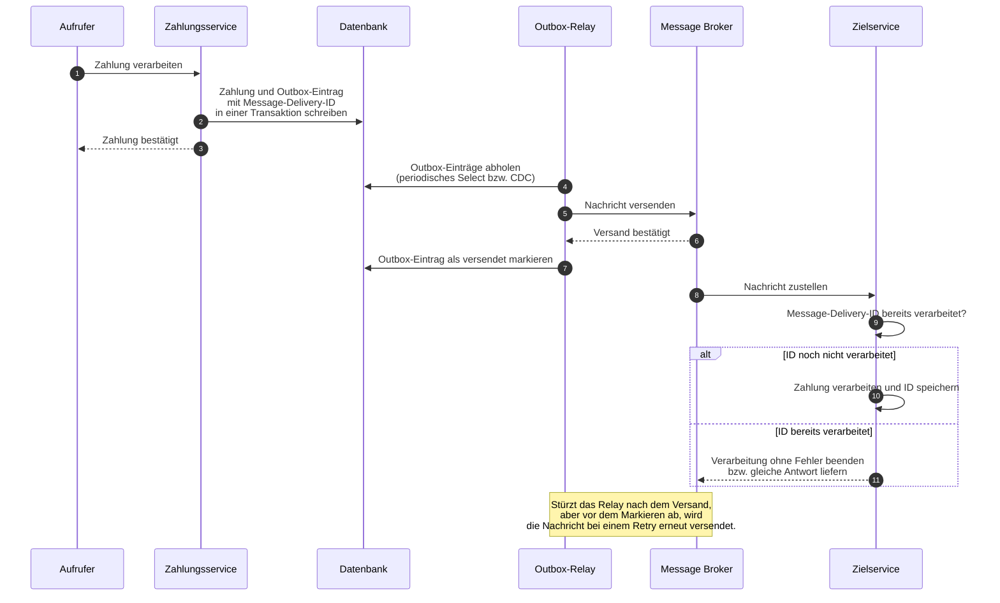

### Summary

- Bei vielen Banken ist die Entscheidung, den Host abzulösen, bereits gefallen. Hauptgründe sind hohe Fixkosten und der Weggang von Entwicklern mit entsprechendem Know-how.
- Der Artikel zeigt, was im Detail zu beachten ist, wenn Anwendungen vom Host in die Cloud migriert werden sollen. Eine der wichtigsten Fragen dabei ist, wie man doppelte Verarbeitungen zuverlässig in einem verteilten System verhindert.
- Außerdem wird darauf eingegangen, dass eine 1:1-Umsetzung von Batch-Jobs nicht die beste Wahl ist, wenn diese eigentlich Events verarbeiten. 

### Ausgangslage

Bei den Legacy-Anwendungen auf dem Host gibt es in der Regel sowohl Batch-Jobs, die zeitgesteuert ausgeführt werden, als auch IMS- und CICS-Transaktionen, bei denen ein Event von außen die Verarbeitung anstößt. Diese können in Assembler, C, COBOL oder Java implementiert sein. Ob die Verarbeitung aktuell im Batch oder in Transaktionen erfolgt, hat naturgemäß einen großen Einfluss auf die Zielarchitektur. Die eingesetzten Programmiersprachen unterscheiden sich jedoch hauptsächlich darin, wie gut sich der vorhandene Programmcode noch analysieren lässt.

Im Fall von Assembler ist neben der Analyse des Codes fast immer eine fachliche Rekonstruktion notwendig, weil sonst leicht Details unter den Tisch fallen. Bei COBOL ist die Codeanalyse deutlich leichter, d. h. hier kann man die Anforderungen an neue Services etwas direkter aus den bestehenden Programmen ableiten. Sind Jobs und Transaktionen bereits in Java implementiert, ist es natürlich sehr viel einfacher, die Businesslogik in einen Spring-Boot-Service zu übernehmen.

### Umsetzung von Batch-Jobs in der Cloud

Bei Transaktionen ist es relativ eindeutig, dass sie in der Cloud-Welt ebenfalls als eventgesteuerte Services implementiert werden sollten. Und bei Batch-Jobs liegt der Gedanke nah, dass man diese in ein Batch-Framework wie *Spring Batch* überführt. In der Praxis findet man aber viele Beispiele, in denen Batch-Jobs auch für die Verarbeitung von eingehenden Nachrichten verwendet wurden. Hier lohnt es sich auf jeden Fall, im ersten Schritt zu schauen, ob es sich um eine echte Batch-Verarbeitung oder in Wirklichkeit um eine versteckte eventgesteuerte Verarbeitung handelt.

In einem Beispiel aus der Praxis wurden Batch-Jobs für die Erstellung und Verarbeitung von Kontoauszügen verwendet. Hier gab es sowohl für die Erstellung von Kontoauszügen (camt.053 an Bankrechner) aus den Tagesumsätzen als auch für den Eingang von Kontoauszügen von anderen Banken (Empfang von camt.053 über SWIFT) zeitgesteuerte Jobs. Während es im ersten Fall vollkommen in Ordnung ist, die Jobs jeden Abend laufen zu lassen, soll beim Eingang von Kontoauszügen die Verarbeitung und ggf. Weiterleitung möglichst zeitnah erfolgen. Bei der Auszugserstellung würde man also mit einem zeitgesteuerten Service starten, wobei die weitere Verarbeitung dann auch asynchron durch weitere Services erfolgen kann. Wie das technisch funktioniert, ist weiter unten erklärt. Für den Eingang von Kontoauszügen hingegen ist es besser, direkt einen eventgesteuerten Service zu implementieren, der direkt bei Eingang eines Auszugs mit der Verarbeitung startet.

### Wann kommen Batch-Frameworks dennoch infrage?

| Kriterium          | Batch                                                                                   | Event-basiert                                                                           |
|--------------------|-----------------------------------------------------------------------------------------|-----------------------------------------------------------------------------------------|
| Zeitpunkt / Latenz | Berichte, Tagesabschlüsse, die zu einem bestimmten Zeitpunkt vorliegen müssen           | Ergebnis muss ohne Verzögerung vorliegen                                                |
| Datenvolumen       | Massenverarbeitung                                                                      | Verarbeitung einzelner Nachrichten                                                      |
| Fehlertoleranz     | Fehler treten selten auf bzw. es ist ein sauberer Rerun notwendig                       | Eine fehlerhafte Nachricht darf die Verarbeitung anderer Nachrichten nicht beeinflussen |
| abhängige Systeme  | Aufrufer arbeiten ebenfalls batch-basiert                                               | Aufrufer erwartet zeitnah eine Antwort                                                  |
| Konsistenz         | Daten müssen zu einem bestimmten Zeitpunkt (*Cut-off*) in einem bestimmten Zustand sein | Konsistenz muss für jede einzelne Transaktion gewährleistet sein                        |

Aus der Tabelle kann man ablesen, dass sowohl die Art der Daten und Verarbeitung, die Abhängigkeit zu anderen Systemen, die Fehlertoleranz, das Volumen und die Anforderung an die Konsistenz der Daten zu betrachten sind. Ein klassischer Fall, in dem man auch in der Cloud noch Batch-Jobs einsetzen würde, ist die Erstellung von Berichten, für die umfangreiche Berechnung und Datenanalysen notwendig sind. Eingehende Nachrichten wie Zahlungen oder Kontoauszüge sollten jedoch immer eventgetrieben implementiert werden.

Wenn nur einzelne Funktionen zeitgesteuert ausgeführt werden müssen, ist ein Batch-Framework zu viel Overhead. Hier könnte man entweder mit einfachen Timern arbeiten oder, wenn sowieso eine Prozess-Engine wie *Camunda* zum Einsatz kommt, Workflows mit zeitgesteuerten Triggern dafür verwenden.

### Wie verhindert man doppelte Zahlungen?

Wenn bei der Verarbeitung von Zahlungen eine asynchrone Weiterleitung an den nächsten Service erfolgt, muss sichergestellt werden, dass der Versand zuverlässig und die Verarbeitung im Ziel maximal einmal erfolgt. Beim Versenden muss nämlich gleichzeitig der Status in der Datenbank aktualisiert werden und hierbei kann es zu zwei Fehlerszenarien kommen: Erstens kann das Schreiben in die Datenbank gelingen, aber das Versenden fehlgeschlagen, und zweitens kann umgekehrt das Versenden erfolgreich sein und das Schreiben in die Datenbank misslingen. Im ersten Fall geht die Zahlung verloren und im zweiten Fall wird sie ggf. später ein zweites Mal gesendet.

Um sicherzustellen, dass die Zahlung überhaupt gesendet wird, wird daher das Transactional-Outbox-Pattern verwendet. Dabei wird die Zahlung in eine separate Ausgangs-Tabelle geschrieben, die dann von einem asynchronen Prozess beobachtet wird, der den Versand übernimmt und anschließend den Datenbankeintrag als versendet markiert. Das Beobachten kann dabei durch ein periodisches Select oder Beobachtung des Transaction-Logs per CDC erfolgen. Da die Aktualisierung des Datenbankeintrags nach dem Senden immer noch fehlschlagen kann, würde eine Zahlung bei einem Retry in dem Fall erneut verschickt werden. Wir haben jetzt also das Problem verloren gegangener Zahlungen gelöst, aber müssen uns noch um die Vermeidung einer doppelten Verarbeitung kümmern.

Dazu muss man sicherstellen, dass die Verarbeitung von Nachrichten beim Zielservice idempotent erfolgt, d. h. dass keine Nachrichten verarbeitet werden, die vorher bereits verarbeitet wurden. Dabei hat es sich bewährt, dass der sendende Service eine eindeutige Message-Delivery-ID generiert, die zusammen mit der Nachricht geschickt wird. Der Zielservice überprüft nun beim Empfang einer Nachricht als Erstes, ob diese ID bereits verarbeitet wurde. Falls ja, wird die Verarbeitung ohne Fehler beendet. Erwartet der aufrufende Service eine Antwort, wird die gleiche Antwort wie beim ersten Aufruf zurückgegeben. Diese Methode kann man übrigens auch bei synchronen Aufrufen (z. B. per REST) verwenden, da hier die Antwort des Zielservices durch ein Netzwerkproblem verloren gehen kann und die Anfrage dann bei einem Retry noch einmal gesendet wird.

### Fehlerbehandlung beim Senden und Empfangen von Nachrichten

Tritt beim Senden ein Fehler auf, kann bei Verwendung der beiden beschriebenen Methoden einfach ein Retry gemacht, d. h. das Senden nach einer kurzen Wartezeit wiederholt werden. Doppelte Nachrichten, die durch Retries entstehen können, werden durch die Idempotenz der Zielservices ignoriert.

Auch beim Empfangen von Nachrichten im Zielservice können Fehler auftreten. Hier kommt es darauf an, um welche Art von Fehler es sich handelt. Wenn die Nachricht nicht in der Datenbank gespeichert werden kann, kann man auch hier ein Retry machen. Wenn allerdings die Nachricht gar nicht erst gelesen werden kann, weil man zum Beispiel eine Textnachricht erwartet, aber eine Binärnachricht bekommt, muss diese in eine separate Fehlerqueue geschrieben werden. Alternativ kann man die Nachricht auch in eine separate Datenbanktabelle schreiben, wobei man aber das Problem haben kann, dass das Schreiben, z. B. wegen einer zu großen Nachricht, nicht klappt. Man sollte also vorzugsweise auf eine Fehlerqueue setzen, muss aber darauf achten, wirklich nur Nachrichten auszusteuern, bei denen ein Retry nichts bringt.

Technisch kann man für das Retry beispielsweise *Spring Retry* verwenden, wobei hier das Retry innerhalb von einem Kubernetes-Pod stattfindet, d. h. es gibt keine erneute Lastverteilung für die Folgeaufrufe. Flexibler sind hier Retries, die über die Datenbank synchronisiert werden, zum Beispiel mit Camunda. Hier hat man wiederum den Nachteil, dass man nicht wie bei *Spring Retry* zwischen technischen und fachlichen Fehlern unterscheiden kann, sondern ein Retry bei allen Arten von Fehlern erfolgt.

Der größte Vorteil bei diesem Vorgehen im Vergleich zur Batchverarbeitung ist, dass eine fehlerhafte Nachricht nicht den gesamten Prozess zum Stehen bringt. Stattdessen wird nur die fehlerhafte Nachricht ausgesteuert und alle folgenden werden weiter verarbeitet.

### Fehler- und Performanceanalyse

Da in der Cloud-Welt die Verarbeitung verteilt über mehrere Services erfolgt, stellt sich die Frage, wie man Fehler im Verarbeitungsprozess und Performanceprobleme analysieren kann. Ein naiver Ansatz wäre, einfach auf die Logs der einzelnen Services zu setzen, die man mit Tools wie Grafana im Zusammenspiel mit Loki auch problemlos serviceübergreifend darstellen kann. Das Problem ist allerdings, dass man alle Aufrufe auf Sender- und Empfängerseite mit Log-Statements versehen muss und auch in den Log-Daten ein großer Overhead entsteht, durch den evtl. Fehler nicht mehr so sichtbar sind.

Stattdessen setzt man daher auf Tracing mit OpenTelemetry. Hierbei sendet jeder Service Telemetriedaten (Spans) an einen zentralen Server und ermöglicht damit eine Auswertung von Timing und Fehlern. Damit Aufrufe über mehrere Service hinweg verfolgt werden können, wird bei allen Aufrufen eine Tracing-ID mitgegeben, die die gesamte Aufrufkette eindeutig identifiziert. Dadurch lässt sich beispielsweise eine bestimmte Zahlung über den gesamten Verarbeitungsprozess hinsichtlich Timing und Fehlern analysieren.

### Fazit

Die Migration vom Host in die Cloud ist kein reines Übersetzungsprojekt. Entscheidend ist zunächst, die Ausgangslage zu differenzieren: Batch-Jobs und IMS-/CICS-Transaktionen führen zu unterschiedlichen Zielarchitekturen und die Programmiersprache bestimmt vor allem, wie direkt sich die Fachlogik aus dem Altcode ableiten lässt. Der größte Fallstrick ist die 1:1-Portierung von Batch-Jobs, die in Wirklichkeit eingehende Nachrichten verarbeiten. Wie der Kontoauszug-Eingang zeigt, verbirgt sich hinter einem zeitgesteuerten Job oft eine Event-Verarbeitung, die in der Cloud als eventgesteuerter Service umgesetzt werden sollte – während die klassische Berichtserstellung weiterhin jeden Abend als Batch laufen darf.

Batch bleibt damit auch in der Cloud ein legitimes Mittel, wenn Ergebnisse zu einem bestimmten Zeitpunkt vorliegen müssen. Ob man einen Batch-Job beibehält oder auf Event-basierte Verarbeitung umstellt, sollte man bewusst anhand der Kriterien aus der Entscheidungstabelle treffen. Die Leitfrage dahinter ist einfach: Muss das Ergebnis sofort vorliegen, oder darf es unter kontrollierten Bedingungen später entstehen?

Bei der asynchronen Verarbeitung hängt die Zuverlässigkeit nicht an einem einzelnen Muster, sondern am Zusammenspiel mehrerer Bausteine: Das Transactional-Outbox-Pattern verhindert, dass Nachrichten verloren gehen, idempotente Zielservices verhindern Doppelverarbeitung, eine saubere Fehlerbehandlung mit Retry und Fehlerqueue hält den Gesamtprozess am Laufen und ein lückenloses Tracing macht Fehler und Performanceprobleme über Service-Grenzen hinweg analysierbar. Dieser Verbund ersetzt die Verlässlichkeit, die auf dem Host der transaktionale Monolith geboten hat – und senkt nebenbei die Fixkosten sowie die Abhängigkeit von rarer werdendem Host-Know-how, die in der Regel den Anstoß für die Migration gegeben haben.

Wer vor einer ähnlichen Migration steht, muss weder die Batch-Welt komplett verlassen noch Host-Transaktionen 1:1 nachbauen. Wer seine Workloads nach diesen Kriterien einordnet und die beschriebenen Muster konsequent anwendet, migriert Workload für Workload ohne Ausfallzeiten und ohne doppelte Verarbeitung. Wenn Sie Unterstützung bei der Einordnung oder Umsetzung benötigen, vereinbaren Sie gerne ein unverbindliches [30-minütiges Fachgespräch](/termin).
